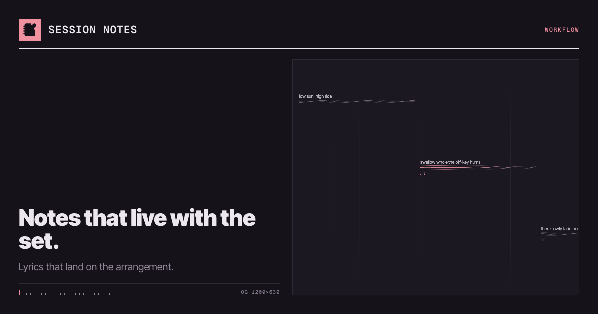
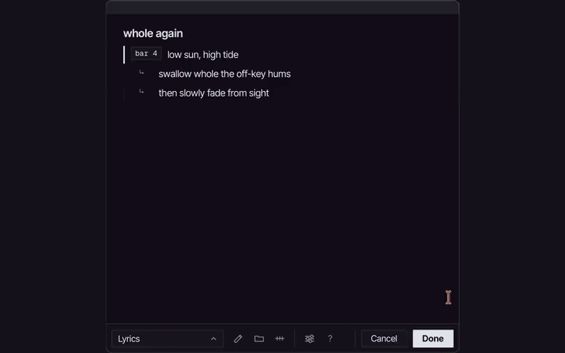
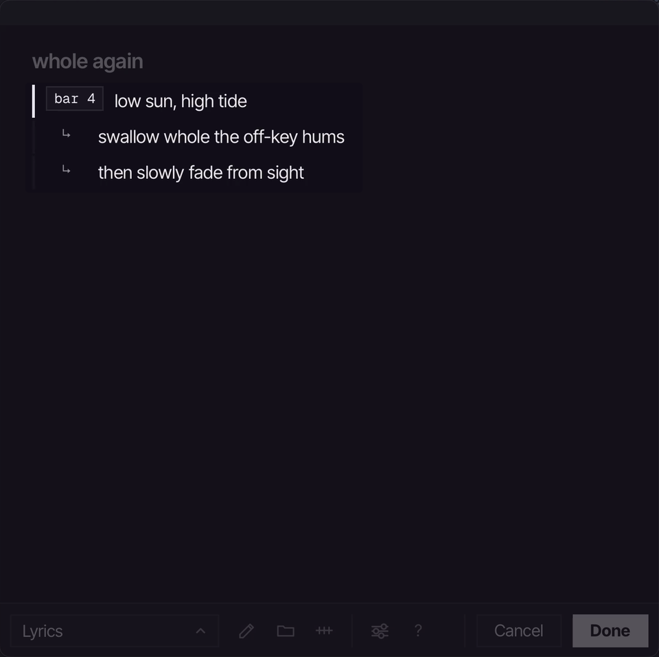
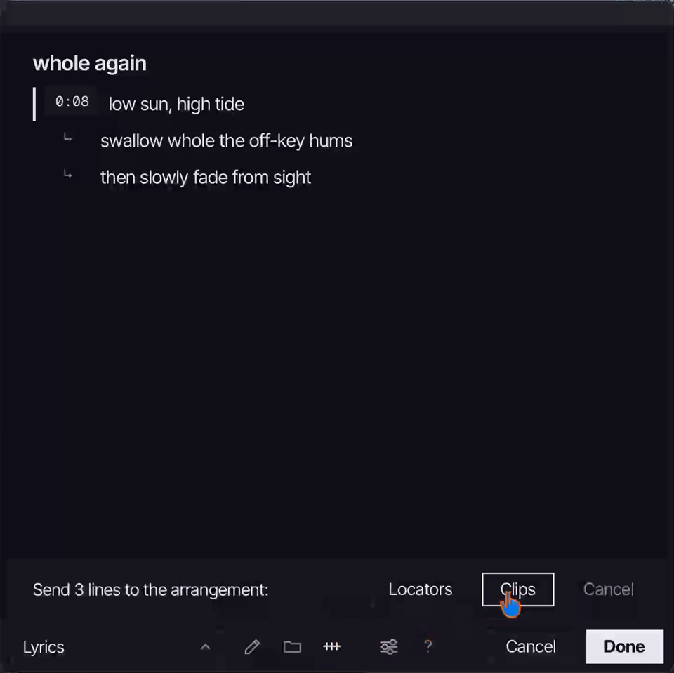
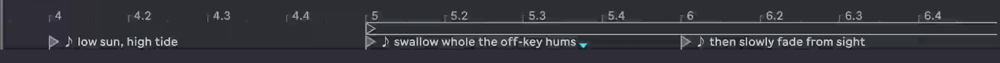
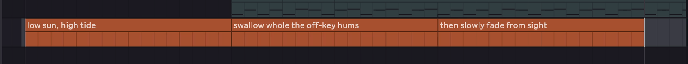
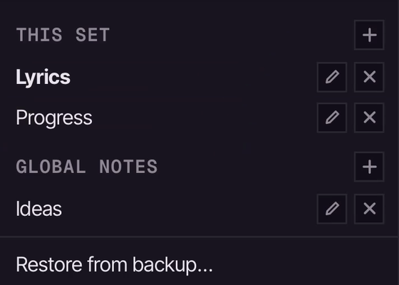
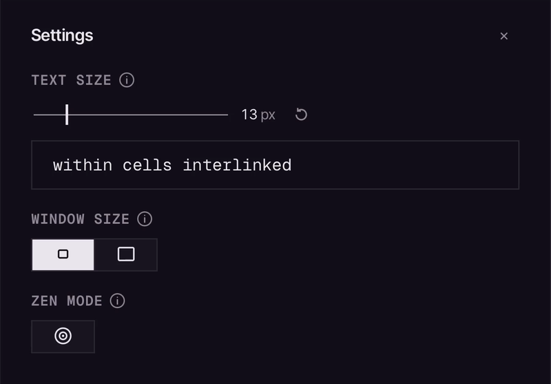
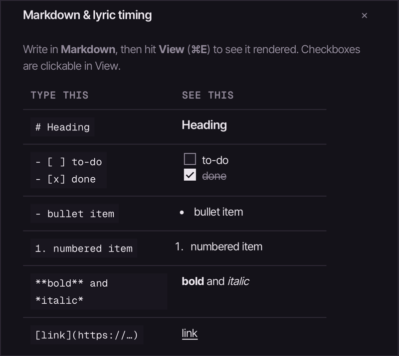
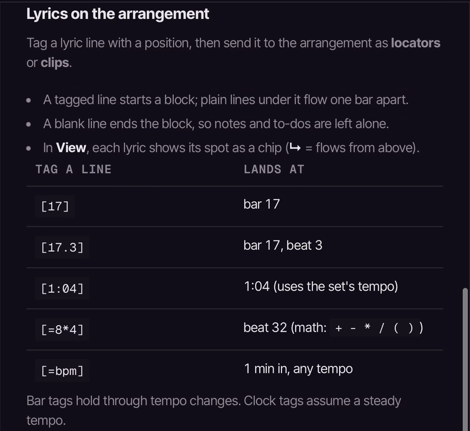

# Session Notes

Simply sketch.

<picture>
  <source media="(prefers-color-scheme: dark)" srcset="assets/session-notes-cover.png">
  <source media="(prefers-color-scheme: light)" srcset="assets/session-notes-cover-light.png">
  
</picture>

**Notes that live with the set. Lyrics that land on the arrangement.**

A Markdown notepad inside **Ableton Live 12**, built on the Ableton Live Extensions SDK. Jot lyrics, ideas and to-dos without leaving Ableton Live. Tag a lyric line with a bar or a time and send it straight onto the arrangement.

> Requires Ableton Live 12.4.15 beta or later, with the Extensions feature (SDK `1.0.0-beta.0`).

## In pictures



Files to share: [loop, MP4](media/loop-night.mp4) · [loop, GIF](media/loop-night.gif) · [still](media/loop-night.png)

## See it in action

Tag the first line of a verse with where it goes. In **View**, each line shows its spot; open the send bar and pick **Locators** or **Clips**:

| Tag a line | Send it |
| :---: | :---: |
|  |  |

**As locators**, named on the ruler:



**As clips**, on the Session Notes track:



**Set notes and global notes** share one picker. Set notes belong to this set; global notes are in every set:



## Features

- **Markdown, rendered by default.** Write in Markdown; the pencil button or `⌘E` switches between **View** and **Edit**. Headings, bullet and numbered lists, bold and italic, blockquotes, links, and to-dos (`- [ ]` / `- [x]`) you can tick in View.
- **Lyrics on the arrangement.** Tag a lyric line with its position, then send the block as **locators** or **clips**. A position can be a bar (`[17]`), a bar and beat (`[17.3]`), a time (`[1:04]`), or a bit of math (`[=8*4]`, `[=bpm]`). Untagged lines under a tag follow one bar apart, and a blank line ends the block, so your other notes and to-dos are left alone.
- **Two kinds of notes:**
  - **Set notes** are saved inside the set and **travel with it**: Save As, moving or renaming the project folder, another computer, a collaborator. Keep as many as you like per set.
  - **Global notes** stay on this computer and are in every set.
- **Manage notes in place.** The note picker lists **This set** and **Global notes**; create, rename and delete notes right there.
- **Backups.** Every save also keeps a backup on this computer. **Restore from backup…** in the note picker brings back an earlier version.
- **Autosave on close.** **Done**, `⌘S` or `Esc` saves and closes; **Cancel** throws away the edits since you opened the pad.
- **Remembers your place.** Reopens the note you had open last.
- **File location.** The folder button shows where a global note's file is, or a set note's backup, with a button to copy the path.
- **Settings.** Note text size, a compact or regular window, and **Zen Mode**, which hides the toolbar for distraction-free writing.
- **Built-in help** (the `?` button) for Markdown and lyric timing.

| Settings | Markdown help | Lyric-timing help |
| :---: | :---: | :---: |
|  |  |  |

## Install

1. Download the latest `Session-Notes-<version>.ablx` from the [Releases](https://github.com/swwallowws/ableton-session-notes/releases/latest) page.
2. In Ableton Live: **Settings → Extensions**, then drag the `.ablx` file onto the page.
3. Right-click a track, clip slot, or scene → **Extensions → Session Notes: Open…**

## Usage notes

- Open it from the right-click menu on an **audio or MIDI track, clip slot, or scene**. (The SDK has no global menu, so it attaches to the things you can reach almost anywhere.)
- **Where set notes live:** the first **Done** that saves set notes adds a MIDI track named **Session Notes** with no devices, so it never makes a sound. Its clips carry your notes, so keep the track. Lyric clips land on it too. A set that already has a **Lyrics** track from an earlier version keeps using that one.
- After **Done**, Ableton Live shows the set as changed. Save the set to keep the notes in it; until then they're safe in the backup.
- **Coming from 0.2.x:** global notes come across on their own. Ableton Live no longer lets extensions read project folders, so drag your old set notes (the `.md` files in a project's `Session Notes/` folder) onto the pad to add them.

## Develop

The Ableton Extensions SDK isn't included in this repo (its license doesn't allow redistribution). Get `ableton-extensions-sdk-1.0.0-beta.0.tgz` and `ableton-extensions-cli-1.0.0-beta.0.tgz` from Ableton and place them in `vendor/` before installing.

Copy `.env.example` to `.env` and point `EXTENSION_HOST_PATH` at your local Ableton Live install (read by `@ableton-extensions/cli`, not tracked in git).

```bash
npm install
npm start        # build + run in Ableton Live's Extension Host (Developer Mode must be ON)
npm test         # every test file in test/
npm run build    # dev bundle
npm run package  # production bundle → Session-Notes-<version>.ablx
npm run demo     # the web demo, served locally
```

Node ≥ 22.11 is required (the SDK's minimum). The source is in `src/`:

- `extension.ts`: the host side, wiring everything together
- `interface.html`: the pad (the web view)
- `session.ts`: opening and saving a set's notes
- `setdata.ts` and `codec.ts`: reading and writing set notes as clips on the Session Notes track
- `reconcile.ts`: deciding which notes the pad shows when the set and the backup differ
- `backups.ts`: backups, Restore, and bringing notes across from older versions
- `notes.ts`: global notes and the pad's saved state
- `timeline.ts`: where each lyric line lands on the arrangement

## License

MIT © Bengisu ([@swwallowws](https://github.com/swwallowws))
