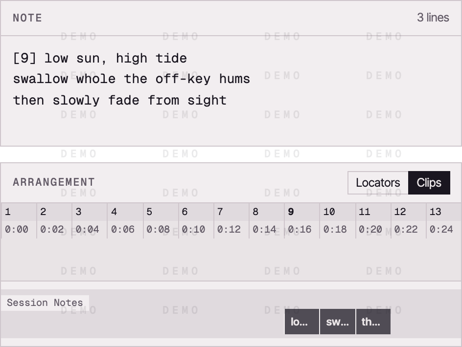

# Session Notes

Simply sketch.

<picture>
  <source media="(prefers-color-scheme: dark)" srcset="assets/session-notes-cover.png">
  <source media="(prefers-color-scheme: light)" srcset="assets/session-notes-cover-light.png">
  
</picture>

**Notes that live with the set. Lyrics that land on the arrangement.**

A minimal Markdown notepad for **Ableton Live 12**, built on the [Ableton Live Extensions SDK](https://ableton.com). Jot lyrics, ideas, and to-dos without leaving Ableton Live, with clean, native-feeling typography and a render-by-default Markdown view. Tag a lyric line with a bar or timecode and drop it straight onto the arrangement.

> Requires Ableton Live 12.4.15 beta or later, with the Extensions feature (SDK `1.0.0-beta.0`).

## In pictures



Files to share: [still, Paper](media/playground-paper.png) · [still, Night](media/playground-night.png)

## Features

- **Markdown, rendered by default.** Write in Markdown; a single tap or `⌘E` toggles between **View** and **Edit**. Headings, bullet/numbered lists, bold/italic, blockquotes, links, and clickable GFM task lists (`- [ ]` / `- [x]`).
- **Lyrics on the arrangement.** Tag a lyric line with its position, then send the block to the arrangement as **locators** or **clips**. Positions can be a bar (`[17]`), a bar and beat (`[17.3]`), a timecode (`[1:04]`), or a bit of math (`[=8*4]`). Untagged lines under a tag flow one bar apart, and a blank line ends the block so your prose and to-dos are left alone.
- **Two kinds of notes:**
  - **Set notes** are saved inside the set and **travel with it**: Save As, moving or renaming the project folder, another computer, a collaborator. Keep as many as you like per set.
  - **Global notes** stay on this computer and are in every set.
- **Manage notes in place.** The note picker lists **This set** and **Global notes**; create, rename, and delete notes right there.
- **Backups.** Every save also keeps a backup on this computer. **Restore from backup…** in the note picker brings back an earlier version.
- **Settings panel.** Tune the note text size, pick a compact or default window, and flip on **Zen Mode** for distraction-free writing.
- **Autosave on close.** Close the pad (**Done**, `⌘S`, or `Esc`) and it saves; **Cancel** discards edits made since you opened it.
- **Remembers your place.** Reopens whatever note you had open last.
- A built-in **Markdown & lyric-timing help** (the `?` button).

## See it in action

Write in Markdown, hit **View** to render it, then tag any lyric line with its position and send the block to the arrangement:

| In the note (View) | Ready to send |
| :---: | :---: |
|  |  |

They land on the arrangement as named **locators** (on the ruler) or **clips** (on the Session Notes track), lined up to the bars and timecodes you tagged:

| As locators | As clips |
| :---: | :---: |
|  |  |

Set notes and global notes share one picker:


Settings and the built-in help are a button away:

| Settings | Markdown help | Lyric-timing help |
| :---: | :---: | :---: |
|  |  |  |

Try it yourself: paste this into a note, switch to **View**, then press the send-to-arrangement button.

```markdown
# Whole Again

Key: A minor · 128 BPM · ref: that Bonobo track

- [x] Track the drums
- [ ] Re-amp the bass on the second drop
- [ ] Mix the vocal louder in the bridge

Verse: keep it breathy, close-mic.

[1] low sun, high tide
swallow whole the off-key hums
[1:04] then slowly fade from sight
```

The `#` heading, the prose line, and the to-dos are left out; only the tagged block is sent to the arrangement. The untagged `swallow whole the off-key hums` flows one bar after `[1]`.

## Install

1. Download the latest `Session-Notes-<version>.ablx` from the [Releases](https://github.com/swwallowws/ableton-session-notes/releases/latest) page.
2. In Ableton Live: **Settings → Extensions**, then drag the `.ablx` file onto the page.
3. Right-click a track, clip slot, or scene → **Extensions → Session Notes: Open…**

## Usage notes

- Open it from the right-click menu on an **audio/MIDI track, clip slot, or scene**. (The SDK has no global menu, so it attaches to the objects you can reach almost anywhere.)
- **Where set notes live:** the first **Done** that saves set notes adds a MIDI track named **Session Notes** with no devices, so it never makes a sound. Its clips carry your notes, so keep the track. Lyric clips land on it too. A set that already has a **Lyrics** track from an earlier version keeps using that one.
- After **Done**, Ableton Live shows the set as changed. Save the set to keep the notes in it; until then they're safe in the backup.
- **Coming from 0.2.x:** global notes come across on their own. Ableton Live no longer lets extensions read project folders, so drag your old set notes (the `.md` files in a project's `Session Notes/` folder) onto the pad to add them.

## Develop

The Ableton Extensions SDK isn't included in this repo (its license doesn't allow redistribution). Get `ableton-extensions-sdk-1.0.0-beta.0.tgz` and `ableton-extensions-cli-1.0.0-beta.0.tgz` from Ableton and place them in `vendor/` before installing.

Copy `.env.example` to `.env` and point `EXTENSION_HOST_PATH` at your local Ableton Live install (read by `@ableton-extensions/cli`, not tracked in git).

```bash
npm install
npm start        # build + run in Ableton Live's Extension Host (Developer Mode must be ON)
npm run build    # dev bundle
npm run package  # production bundle → Session-Notes-<version>.ablx
```

Node ≥ 22.11 is required (the SDK's minimum). Source lives in `src/extension.ts` (host logic) and `src/interface.html` (the webview UI).

## License

MIT © Bengisu ([@swwallowws](https://github.com/swwallowws))
